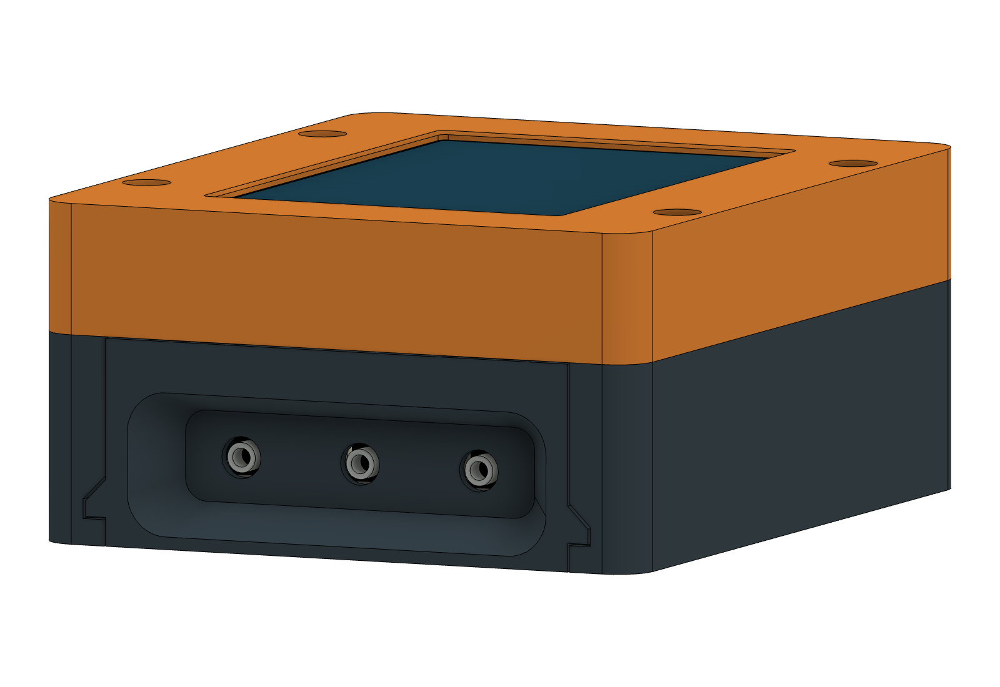
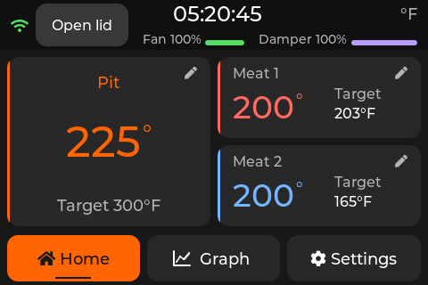

#  Pit Claw

<p align="center">
  
</p>

*The current [Fusion r13 enclosure](enclosure/fusion-r13/README.md), shown as a CAD rendering.*

[](https://github.com/yevgenb/pitclaw/actions/workflows/ci.yml)

BBQ temperature monitor and controller built around the WT32-SC01 Plus: an
ESP32-S3 with a 3.5-inch, 480×320 landscape capacitive touchscreen. Pit Claw reads
one pit probe and two meat probes, controls a blower and optional servo damper,
and provides a web dashboard for monitoring and control. The touchscreen and
temperature control work without Wi-Fi.

This is an **independently maintained fork** of
[MrMatt57's Pit Claw](https://github.com/MrMatt57/pitclaw). The original project
provides the ESP32 touchscreen controller, probe monitoring, PID fan/damper
control and web interface. This fork develops the hardware and enclosure and
refines the firmware through bench checks and real cooking sessions. It is
maintained separately; it is not an official upstream release.

**Start here:** [Builder's guide](docs/build-guide.md) ·
[Prototype downloads](https://github.com/yevgenb/pitclaw/releases/tag/prototype-2026-11-14) ·
[The build story](docs/build-story.md) ·
[Report your build](https://github.com/yevgenb/pitclaw/issues/new?template=build_report.yml)

## What this fork changes

- **Custom carrier PCB:** routed KiCad design with PCB-mounted connectors,
  USB-C PD power and wall-priority power selection, with BOM and wiring records.
- **Redesigned enclosure:** editable Fusion model, printable parts, fit coupons,
  adjustable display seating and four M3 accessory mounting points.
- **Controller refinements:** warm-up airflow regression coverage, clamped
  anti-windup, explicit lid controls and damper calibration.
- **Web access and diagnostics:** shared-password authentication, authenticated
  OTA/downloads, reverse-proxy support and bounded Wi-Fi event logging.

This is a **prototype for experienced builders**. The latest PID update needs
a physical cold-start overshoot check; the revised display seat needs a print
fit check; carrier load and thermal qualification remain. See the
[builder's guide](docs/build-guide.md) for what to test and how to report it.

## Current project state

As of **13 November 2026**:

| Area | State |
| --- | --- |
| Firmware | Device build **0.2.0-wifi-log.1**, web UI build **6**. Installed through OTA; version, login, live updates and saved Wi-Fi diagnostics verified after restart. |
| Touchscreen | LVGL Home, Graph, Settings, temperature editors, alarms, manual/automatic lid pauses, adjustable lid timeout, damper calibration and first-boot setup. Works without a web login or Wi-Fi. |
| Web interface | Live temperatures, history and predictions, CSV export, shared-password authentication, lid controls, Wi-Fi log download and manual firmware OTA. Supports an Nginx path prefix. |
| Carrier PCB | **Rev B-T2F0-A5807-S4** routed prototype. Recorded KiCad ERC, DRC, schematic parity, and unconnected-item checks pass. A reviewed bare-board fabrication package is available; physical qualification remains. |
| Enclosure | **Fusion r13**, 104 × 86 × 44.9 mm: five complete printable parts, coupons and optional display-seat shims. The latest top corrects the reported display gap; the revised print still needs a physical fit check. |

The November 13 checks passed the firmware build, **56 targeted native tests**,
real QuickPID/controller integration tests, authentication/download checks, and
web UI cache/reverse-proxy checks. The recorded November 12 warm-up cutoff is
now a regression fixture. The updated PID still needs a physical cold-start
overshoot check. Software and CAD checks do not qualify probe accuracy, PCB
loads, thermal behavior or printed fit.

## Touchscreen



The current dashboard uses large temperature readings, rounded cards and
navigation buttons, neutral status labels, and consistent edit icons. Smaller
degree symbols follow changing values and disappear for disconnected probes.
The image above is a native 480×320 LVGL render with example readings.

- Tap the pit card to change its setpoint, or a meat card to edit that probe's
  target. Tap for one-degree steps or hold for five-degree steps; Cancel discards
  the draft value.
- Switch between Fahrenheit and Celsius without changing the stored control
  targets. Graph history uses elapsed sample time and a dashed setpoint line.
- Alarm controls remain available on Home, Graph, Settings, and above an open
  editor. Disconnected probes display dashes.
- Setup provides Back navigation, Wi-Fi connection feedback, live probe checks,
  and separate fan, servo, and buzzer test buttons.
- **Open lid / Close lid** pauses and resumes airflow. Settings provides automatic
  lid detection and a 30–600 second timeout. **Damper setup** tests and saves the
  actual closed/open servo endpoints.

## Control and monitoring

- **Three probe inputs:** one pit and two meat channels, using calibrated
  thermistor probes with 2.5 mm jacks. Thermoworks Pro-Series is the intended
  probe family; other probes require suitable coefficients and calibration.
- **PID control:** fan-only, fan-and-damper, and damper-priority modes, with
  clamped anti-windup throughout warm-up and settling. Default gains are
  **P=4, I=0.03, D=5**, computed every four seconds. Pit-probe faults stop the fan
  and close the damper; unplugged meat probes are optional.
- **Alarms:** local buzzer, browser audio and browser notifications where supported.
  Pushover settings exist in the configuration schema; delivery is not implemented.
- **Cook sessions:** five-second sampling, a rolling 600-point device history
  (about 50 minutes), restart recovery, CSV export of that retained window and
  estimated meat completion times. Download before starting a new session.
- **Configuration:** persistent probe/touch calibration, damper endpoints, fan
  mode, web authentication and Wi-Fi reconnect.
- **Wi-Fi diagnostics:** 32 recent connection/IP events, saved across restarts
  with rate-limited writes. Download under **Settings → Diagnostics**. This records
  events; it does not actively test router reachability.

## Web interface


Open `http://bbq.local` or the IP shown in the controller's Settings from a device
on the same network. A DHCP reservation can keep that address consistent.
The dashboard uses WebSocket
updates and also works behind an Nginx
directory prefix such as `/newbbq/`; see the
[reverse-proxy guide](firmware/docs/reverse-proxy.md).

PWA installation, service-worker caching, and browser notifications need a secure
context; use HTTPS on the reverse proxy for those features. Live readings still
require a connection to the controller.

Enable a shared password in **Settings → Access** before exposing the dashboard
outside the LAN. Authentication protects API, WebSocket and firmware-upload
routes. Login sessions expire after 12 hours and end on restart; refresh and sign
in again after OTA. Local touchscreen control remains available.

For a network problem, download **Settings → Diagnostics → Download Wi-Fi log**
after reconnecting. Its fixed 1,040-byte checkpoint retains 32 events; changed
logs are saved at most once per minute. The newest unsaved entries can be lost
on a sudden power cut. Signal strength and a green Connected label alone do not
confirm usable IP connectivity. See the
[Wi-Fi diagnostics guide](docs/firmware-development.md#wi-fi-event-diagnostics).

Manual firmware updates are available at `/update`. Automatic GitHub release
checks are disabled in the current PlatformIO configuration. `firmware.bin`
includes the web UI, so one firmware upload updates both interfaces while
preserving LittleFS settings and session history. Reboot resets runtime pit/meat
targets: the pit starts at 225°F and meat targets are cleared.

## Hardware and enclosure

The active design is the
[Rev B-T2F0-A5807-S4 carrier](hardware/carrier-revb/README.md), a 60×92 mm board
with PCB-mounted probe jacks, a blower/servo connector, a 12 V barrel inlet,
an Adafruit 5807 USB-C PD module, and a Traco TSR 2-2450N 5 V / 2 A converter.
A relay selects wall power when present and USB-PD otherwise.

| Resource | Contents |
| --- | --- |
| [Carrier design](hardware/carrier-revb/README.md) | Circuit, power limits, module mounting, and remaining qualification work |
| [Wiring guide](docs/wiring.md) | Current connector pin assignments and assembly wiring |
| [Carrier BOM](hardware/carrier-revb/bom/README.md) | Current parts and recorded pricing |
| [Verification](hardware/carrier-revb/verification/README.md) | Native electrical/layout checks and physical validation limits |
| [JLCPCB prototype package](hardware/carrier-revb/fabrication/jlcpcb-2026-09-06/README.md) | Reviewed Gerber/drill archive for a small bare-board order |
| [Fusion enclosure model](enclosure/fusion-r13/pitclaw-enclosure-r13.f3d) | Editable 104×86×44.9 mm controller case |
| [STL package and print guide](enclosure/fusion-r13/README.md) | Top, bottom, probe fascia, display retainer, USB base, coupons, and assembly guide |

The linked fabrication records describe a prototype package. Carrier load,
relay-transfer, thermal and module-fit qualification remain documented hardware
work. Use the [enclosure guide](enclosure/README.md) for current r13 print files,
the display-seat correction and the separate fan/damper assembly. Reprint only
the revised top for the display-gap correction; follow the shim-fitting procedure
before tightening the retainer.

## Getting started

### 1. Set up the tools

```sh
git clone https://github.com/yevgenb/pitclaw.git
cd pitclaw
```

Install PlatformIO CLI. Windows users can use the repository's setup script:

```powershell
# Run from an elevated PowerShell in the repository root
powershell -ExecutionPolicy Bypass -File scripts\setup-dev.ps1
```

See [firmware development](docs/firmware-development.md) for prerequisites.
Use the current carrier and wiring guides when assembling hardware.

### 2. Build and flash

Run from `firmware/` with the WT32-SC01 Plus connected over USB:

```sh
cd firmware
pio run -e wt32_sc01_plus
pio run -e wt32_sc01_plus --target upload

```

No filesystem upload is needed for the web UI. A filesystem upload replaces
LittleFS and can erase configuration and session data; normal firmware updates
preserve configuration, session data and Wi-Fi event checkpoints. The display
board's programming USB port requires
opening the enclosure; the carrier's external USB-C PD port is for power.

For later manual firmware OTA, open `http://bbq.local/update` and upload
`firmware/.pio/build/wt32_sc01_plus/firmware.bin` from the repository root.

### 3. Complete setup

1. Select °F or °C in the touchscreen wizard.
2. Follow the Wi-Fi QR code and portal instructions, or continue offline with Next.
3. Connect the probes and check their live readings.
4. Tap the fan, servo, and buzzer test buttons and confirm each device operates.
5. Finish setup to enter the dashboard.

Hold a finger on the touchscreen for 10 seconds during the boot splash to request
a factory reset.

## Development and validation

The SDL2 desktop simulator runs the production LVGL screens and serves the web
UI at `http://localhost:3000`. Run these commands from `firmware/`:

```sh
# Native control-logic regression tests
pio test -e native

# Real QuickPID, configuration and command integration checks
python3 test/lid/run_checks.py

# Authentication, private-file and HTTP/WebSocket integration checks
python3 test/auth/run_checks.py

# Desktop simulator; requires SDL2
pio run -e simulator
.pio/build/simulator/program

# Headless production LVGL interaction checks; run after building the simulator
python3 test/ui/run_checks.py

# Web regression checks (POSIX shell)
for test in test/web/*.cjs; do node "$test"; done
```

On Apple Silicon with Homebrew SDL2, use
`CPATH=/opt/homebrew/include pio run -e simulator` if the headers are not found.
The [display test guide](firmware/test/ui/README.md) explains the capture command
and alternate SDL paths. UI screenshots can be regenerated locally on demand.

| Guide | Topics |
| --- | --- |
| [Firmware development](docs/firmware-development.md) | Build, flash, architecture, and configuration |
| [Display checks](firmware/test/ui/README.md) | Real LVGL pointer events, layout checks, and PNG capture |
| [Web UI development](docs/web-development.md) | Simulator profiles, web assets, and WebSocket protocol |
| [Reverse proxy](firmware/docs/reverse-proxy.md) | Nginx path prefixes, WebSockets, HTTPS, and manual OTA routing |
| [3D printed parts](enclosure/README.md) | Current enclosure, legacy parts, and fan assembly |

## License

The upstream project and this fork currently have no project-wide license
(upstream lists it as TBD). Public availability is not a blanket permission
to reuse or redistribute the work. Licensing remains to be clarified with the
original author and relevant contributors. Existing third-party notices still
apply; this prototype release does not add or replace a license.
