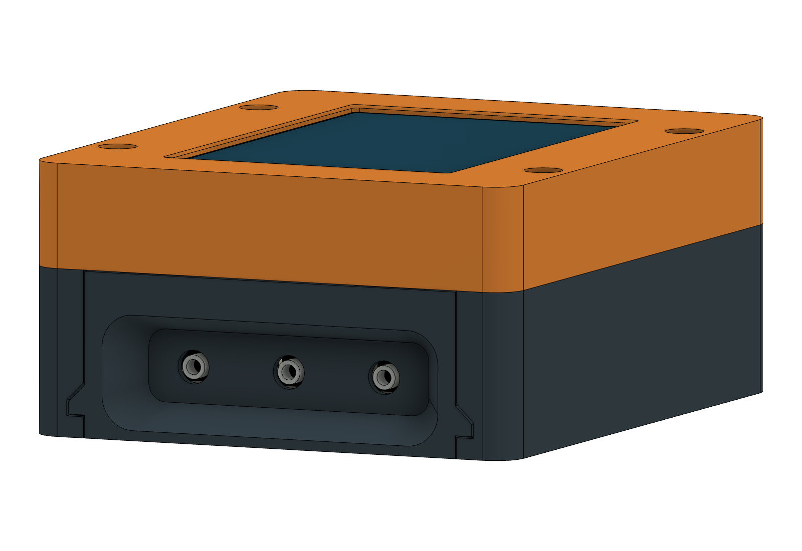
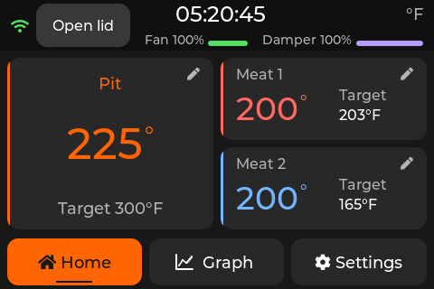

# Building Pit Claw for a Kamado: a prototype preview

14 November 2026

Pit Claw started with [MrMatt57's ESP32-S3 BBQ controller](https://github.com/MrMatt57/pitclaw):
a touchscreen, three temperature probes, PID fan/damper control and a web dashboard.
This independently maintained fork builds on that foundation with a custom
carrier PCB, a redesigned enclosure and firmware changes informed by bench
testing and cooking on a Louisiana Grills K24 Kamado.

*The current enclosure is shown as a CAD rendering, not a photograph. The
revised display seating still needs a physical print-fit check.*

## Making the controller easier to assemble

The carrier design brings the probe, blower/servo and power connections onto a
60 × 92 mm PCB. It includes USB-C PD power and a relay that selects wall power
when present. The KiCad design, wiring, BOM and recorded electrical/layout
checks are available for review; loaded power switching and thermal behavior
still need physical qualification.

The 104 × 86 × 44.9 mm enclosure has a removable probe fascia, separate display
retainer and printed USB-module support. Four M3 mounting points underneath
provide a starting point for a shelf or cart mount. The archive includes the
editable Fusion model, STEP exports, print files and fit coupons. A grill mount
is still at the concept stage.

## Changes that came from cooking

One warm-up session exposed an unexpected airflow cutoff. The firmware now
uses clamped anti-windup throughout warm-up and settling, and that recorded
cutoff has a regression fixture. A physical cold-start test is still needed to
measure overshoot with the revised controller.

A separate incident left the display reporting Wi-Fi connectivity while the
dashboard was unreachable. The root cause was not established. To make a repeat
incident diagnosable, the firmware records the last 32 connection/IP events
with rate-limited persistence and a downloadable log. This adds evidence; it
does not prove that router reachability is fixed.

*Native LVGL render with example readings. It is an interface preview, not a
temperature-control measurement or a real cook graph.*

The fork also adds shared-password web authentication, protected downloads and
OTA, lid controls, damper calibration and reverse-proxy support. The inherited
local touchscreen/control path remains usable without Wi-Fi.

## Looking for early builder feedback

The [prototype release](https://github.com/yevgenb/pitclaw/releases/tag/prototype-2026-11-14)
packages firmware **0.2.0-wifi-log.1 / UI 6**, the **r13** enclosure and the
**Rev B-T2F0-A5807-S4** carrier BOM with checksums and source provenance.
The [builder's guide](https://github.com/yevgenb/pitclaw/blob/prototype-2026-11-14/docs/build-guide.md)
covers assembly, first flashing, OTA and the remaining physical checks.

The firmware build, all **164 native test cases**, real QuickPID/controller
checks, authentication integration checks and web regression checks passed for
this snapshot. All 96 files in the enclosure archive match its recorded
manifest and checked-in sources. These checks do not replace physical testing.

Useful reports include display/enclosure fit, probe calibration, fan startup,
warm-up/overshoot, lid recovery and reconnect behavior. Experienced builders can
[share a build report](https://github.com/yevgenb/pitclaw/issues/new?template=build_report.yml)
with their hardware and measured results. This is a prototype preview; no fixed
temperature accuracy, weather rating or production qualification is claimed.

Thanks to MrMatt57 and the original contributors for the foundation. This fork
is maintained separately and is not an official upstream release. The upstream
project-wide license is still TBD; this preview does not resolve or replace
licensing for inherited work. See [license status](https://github.com/yevgenb/pitclaw/blob/prototype-2026-11-14/README.md#license).
